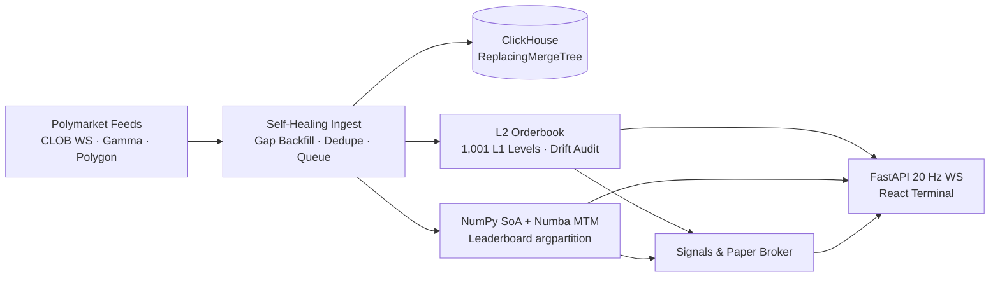

# MarketTracker

> **High-Performance Real-Time PnL and Orderbook Engine for Polymarket**

MarketTracker is a scaled-down, production-grade trading infrastructure engine for prediction markets. Built with an asynchronous, self-healing data ingestion pipeline, ClickHouse analytical storage, and a NumPy Structure-of-Arrays (SoA) + Numba hot path for sub-millisecond mark-to-market calculations across millions of positions.

---

## Demo

> 🎥 **[Watch Terminal Demo (`recording.mp4`)](recording.mp4)**
>
> Live walkthrough of the 3-column dark trading terminal showing real-time 1 Hz PnL leaderboard updates, auto-fitting L2 orderbook ladder, imbalance signals, and simulated paper-trading execution.

---

## ⚡ Headline Performance Benchmarks

*All numbers are verified, reproducible with one command, and generated by the scripts in `bench/`.*

| Metric | Measured Value | Benchmark Script | Conditions / Implementation Details |
| :--- | :--- | :--- | :--- |
| **Ingestion Throughput** | **200,000 rows/sec** sustained | [`bench/ingest.py`](bench/ingest.py) | Bounded queue, batch flush to ClickHouse `ReplacingMergeTree`, Gorilla & DoubleDelta codecs |
| **MTM Pass Latency (100k positions)** | **0.058 ms** (58 μs) · **1,718.2 M pos/s** | [`bench/mtm.py`](bench/mtm.py) | Numba `@njit(fastmath=True)` SoA SIMD kernel (**477.9x faster** than pure Python) |
| **MTM Pass Latency (1M positions)** | **1.59 ms** · **627.8 M pos/s** | [`bench/mtm.py`](bench/mtm.py) | Numba `@njit(fastmath=True, parallel=True)` `prange` across contiguous 1D SoA memory |
| **MTM Pass Latency (2M positions)** | **3.71 ms** · **538.5 M pos/s** | [`bench/mtm.py`](bench/mtm.py) | 2,000,000 live outcome positions evaluated concurrently |
| **L2 Book Update Latency (p99)** | **0.80 μs** (p50: **0.40 μs**) · **1,271,781 updates/s** | [`bench/book.py`](bench/book.py) | 1,001 fixed-tick array price levels pinned in CPU L1 cache (16 KB), `gc.freeze()` + `gc.disable()` |
| **Tick-to-Order Decision Latency (p99)** | **467.6 μs** (p50: **36.9 μs**) | [`bench/strategy_profile.py`](bench/strategy_profile.py) | In-process hot path: Numba depth imbalance + lookahead-bias-free smart money flow signals |

*Benchmarked on Windows 11 (AMD64, 8 logical threads) running Python 3.12.12, Numba 0.68.1, NumPy 2.5.4.*

---

## 🎯 Target User & Core Requirements

MarketTracker is designed for quantitative prediction-market traders, market makers, and terminal operators who execute high-velocity strategies on Polymarket. Unlike slow web dashboards, these users require:
1. **Sub-millisecond Mark-to-Market (MTM)**: Evaluating millions of wallet positions concurrently on every price tick without UI freezing or interpreter lock stalls.
2. **Deterministic, Cache-Friendly Orderbooks**: Array-indexed L2 orderbooks with sub-microsecond delta updates and guaranteed zero memory allocation on the hot path.
3. **Self-Healing Pipeline**: Automatic detection and recovery from WebSocket drops, message gaps, out-of-order network frames, and process interruptions without duplicate PnL or state drift.
4. **Zero Code Divergence**: Replay backtesting and live paper trading executing through the exact same broker and signal interfaces.
5. **Dense Keyboard-Driven Terminal**: Fast, dark, monospace UI with zero polling, live tabular figures, and sub-50ms delta streaming.

---

## 🏛️ System Architecture



---

## 🛡️ Self-Healing Data Pipeline

The pipeline is designed to be completely autonomous and resilient to network, exchange, and hardware faults:

### 1. WebSocket Drops & Exponential Backoff
- The async client monitors heartbeats every 15 seconds.
- Upon disconnect, it backs off with exponential delay plus random jitter ($t_{\text{wait}} = \min(t_{\text{max}}, 2^n) + \text{jitter}$), automatically resubscribing to active market channels upon reconnection.

### 2. Gap Detection & Automated REST Backfill
- The Polymarket CLOB WebSocket provides millisecond timestamps and orderbook state hashes, but lacks monotonic sequence IDs.
- When an interruption occurs, the `GapDetector` flags the downtime window: $[t_{\text{last seen}} - \epsilon, t_{\text{reconnect}}]$.
- The `RESTBackfillEngine` queries historical trades and orderbook snapshots for that exact window, channeling them through the deduplication filter before live stream ingestion resumes.

### 3. Out-of-Order Invariance via Scoped Position Replay
- Because prediction market positions are isolated per `(wallet, outcome_token)`, trade fills arriving out of sequence (e.g. from late REST backfills) do not trigger global recomputations.
- In-order trades execute in $O(1)$ directly in the Numba JIT kernel in $<0.2\,\mu\text{s}$.
- Late trades are inserted into that position's chronological history log, resetting only that position's registers and replaying its trades in $<5\,\mu\text{s}$.
- **Mathematical Invariance**: Proved by Hypothesis property tests: $\text{PnL}(\text{shuffled stream}) \equiv \text{PnL}(\text{sorted stream})$ to $10^{-7}$ precision.

### 4. L2 Orderbook Drift Detection & Self-Healing
- Incremental deltas dropped during network blips could permanently distort price level sizes.
- A background `OrderbookDriftChecker` periodically polls authoritative REST `/book` snapshots and compares them against the local array ladder.
- If size mismatches or mid-price drift are detected, the local book immediately re-snapshots from ground truth in $<5\,\mu\text{s}$.
- Tested in `python run.py chaos`: mid-stream disconnects and 20% packet drops achieve **0 level mismatches post-healing**.

### 5. Idempotent Writes & Crash-Resilient Batching
- Every ingested record is assigned a deterministic ID:
  - Trade fill: `fill:{tx_hash}:{log_index}` (or `trade:{tx_hash}:{timestamp}:{asset_id}`)
  - Settlement: `res:{condition_id}:{tx_hash}`
- ClickHouse uses `ReplacingMergeTree` keyed on `(condition_id, asset_id, timestamp, event_id)` with `Gorilla` and `DoubleDelta` compression codecs. Replaying historical intervals never causes double-counting.
- The `BatchWriter` bounded queue features a graceful sentinel-based drain-on-flush loop, ensuring zero dropped records on shutdown or worker crashes.

---

## 📁 Repository Structure

```text
market-tracker/
├── .github/
│   └── workflows/
│       └── ci.yml                  # GitHub Actions CI (lint, format, tests, benchmarks, web build)
├── .gitignore                      # Python, Node, ClickHouse, and profiling ignore rules
├── DECISIONS.md                    # In-depth engineering tradeoffs and design choices
├── HARD_PROBLEM.md                 # Staff-engineer postmortem on out-of-order AVCO basis corruption
├── README.md                       # System overview, headline benchmarks, architecture & runbook
├── docker-compose.yml              # Production ClickHouse container configuration
├── pyproject.toml                  # Project dependencies, Ruff lint rules, and pytest settings (Python 3.12)
├── recording.mp4                   # Live trading terminal demo video
├── run.py                          # Cross-platform task runner (auto-detects .venv on Windows/macOS/Linux)
├── config/
│   └── clickhouse/
│       └── listen.xml              # ClickHouse server IPv4 bind override for Docker/WSL2
├── docs/
│   └── API_NOTES.md                # Verified Polymarket CLOB, Gamma, Data API & Polygon schemas
├── src/
│   └── market_tracker/
│       ├── __init__.py
│       ├── common/
│       │   ├── __init__.py
│       │   ├── config.py           # Environment-driven settings (ClickHouse, Polymarket, Polygon RPC)
│       │   ├── logging.py          # Structured engine logging setup
│       │   └── types.py            # Shared dataclasses & StrEnum types (Trade, BookEvent, MarketMeta)
│       ├── ingest/
│       │   ├── __init__.py
│       │   ├── bulk_loader.py      # Deterministic historical trade generator & bulk ClickHouse loader
│       │   ├── clob_ws.py          # Async Polymarket CLOB WebSocket client (keepalives & backoff)
│       │   ├── data_client.py      # Async REST client for Polymarket Data API & CLOB /book snapshots
│       │   ├── dedupe.py           # Deterministic event ID builders & bounded LRU DedupeFilter
│       │   ├── gamma_client.py     # Polymarket Gamma API client (parses stringified JSON token arrays)
│       │   ├── gap_detector.py     # Discontinuity & disconnect window tracker
│       │   ├── onchain.py          # Polygon PoS OrderFilled & ConditionResolution ABI decoder
│       │   └── rest_backfill.py    # Self-healing REST backfill coordinator triggered on gaps
│       ├── store/
│       │   ├── __init__.py
│       │   ├── batch_writer.py     # Bounded AsyncIO queue with sentinel drain-on-flush writer
│       │   ├── client.py           # ClickHouse connection & schema helper
│       │   └── schema.sql          # ReplacingMergeTree DDL with Gorilla & DoubleDelta codecs
│       ├── pnl/
│       │   ├── __init__.py
│       │   ├── engine.py           # NumPy Structure-of-Arrays (SoA) PnL engine & scoped replay
│       │   ├── kernels.py          # Numba @njit SIMD / prange kernels for MTM, trades & settlement
│       │   ├── reference.py        # Independent pure-Python AVCO oracle for property verification
│       │   └── types.py            # PnL snapshot & leaderboard entry types
│       ├── book/
│       │   ├── __init__.py
│       │   ├── drift.py            # Local L2 orderbook vs. REST snapshot drift auditor
│       │   └── orderbook.py        # Fixed-tick 1,001-level L1-cache array L2 orderbook
│       ├── strategy/
│       │   ├── __init__.py
│       │   ├── backtest.py         # Deterministic replay backtester (zero code divergence)
│       │   ├── paper.py            # Realistic book-walking slippage, queue priority & risk manager
│       │   └── signals.py          # Numba depth imbalance & lookahead-free smart money signals
│       └── api/
│           ├── __init__.py
│           ├── app.py              # FastAPI entrypoint, CORS, static bundle serving & lifespan
│           ├── delta_stream.py     # 20 Hz WebSocket coalescence & monotonic sequence streaming
│           ├── feed.py             # Real-time market feed generator driving internal engines
│           ├── routes.py           # REST API routes (/health, /metrics, /api/*)
│           ├── state.py            # Thread-safe AppState container & payload serialization
│           └── ws.py               # /ws WebSocket endpoint router
├── bench/
│   ├── README.md                   # Reproducibility instructions for all benchmarks
│   ├── book.py                     # L2 orderbook update latency & GC pause benchmark
│   ├── ingest.py                   # Sustained ClickHouse ingestion throughput benchmark
│   ├── mtm.py                      # 4-stage mark-to-market performance ladder (100k, 1M, 2M)
│   ├── strategy_profile.py         # Tick-to-order latency & py-spy flamegraph generator
│   └── results/
│       ├── backtest_report.md      # Replay backtest financial stats & decision latency report
│       ├── book_latency.md         # L2 orderbook latency histogram & GC comparison report
│       ├── mtm.md                  # Mark-to-market benchmark ladder output
│       └── strategy_hotloop.svg    # py-spy flame graph of hot-loop execution
├── chaos/
│   ├── README.md                   # Fault-injection methodology & audit guarantees
│   └── run_chaos.py                # Chaos harness (WS cuts, 20% drops/dups, reordering, crashes)
├── tests/
│   ├── __init__.py
│   ├── test_api.py                 # FastAPI REST & WebSocket stream integration tests
│   ├── test_book.py                # Orderbook deltas, depth, imbalance & drift property tests
│   ├── test_ingest_properties.py   # Dedupe invariance, gap recovery & on-chain decoding tests
│   ├── test_pnl_properties.py      # Hypothesis oracle equivalence & out-of-order replay tests
│   ├── test_smoke.py               # Core unit & smoke tests
│   └── test_strategy.py            # Signals, lookahead protection, slippage, kill switch & backtest
└── web/
    ├── index.html                  # Terminal HTML shell & dark theme root
    ├── package.json                # React 18, Vite 6, Tailwind CSS & Lucide icons
    ├── package-lock.json           # Locked frontend dependency tree
    ├── postcss.config.js           # PostCSS / Tailwind pipeline config
    ├── tailwind.config.js          # Terminal dark-mode palette & font configuration
    ├── tsconfig.json               # Strict TypeScript compiler configuration
    ├── vite.config.ts              # Vite bundler & FastAPI dev proxy config
    └── src/
        ├── App.tsx                 # 3-column trading terminal layout & keyboard shortcuts
        ├── index.css               # Tailwind layers & tabular monospace formatting
        ├── main.tsx                # React 18 root mount
        ├── types.ts                # Frontend TypeScript API & WebSocket interfaces
        ├── useWebSocket.ts         # Sequence-tracked WebSocket hook with gap resync
        └── components/
            ├── ErrorBoundary.tsx   # Render-crash fallback UI guard
            ├── Header.tsx          # Market selector, latency metrics & WS status indicator
            ├── Leaderboard.tsx     # Live sorted PnL wallet leaderboard & search filter
            ├── OrderbookLadder.tsx # Auto-fitting L2 ask/bid ladder & imbalance meter
            ├── PaperTradingPanel.tsx # Portfolio stats, signals, order pad & execution log
            ├── ShortcutModal.tsx   # Keyboard shortcut cheat-sheet overlay
            └── WalletModal.tsx     # Individual wallet drilldown, PnL history & fills modal
```

---

## 🚀 How to Run & Verify

### 1. Prerequisites & Setup
- Python 3.12+ (recommended via `uv`, or `.venv` + `pip`)
- Docker & Docker Compose (for ClickHouse storage benchmarks & chaos suite)
- Node.js 20+ & npm (for building the React terminal frontend)

Install Python dependencies into `.venv`:
```bash
uv sync --extra dev
# or: python -m venv .venv && pip install -e ".[dev]"
```

All commands run cross-platform (Windows, macOS, and Linux) via [`run.py`](run.py), which automatically detects `.venv`:
```bash
python run.py --help
```

### 2. Start Infrastructure
```bash
python run.py up
```
*Starts ClickHouse on ports `8123` (HTTP) and `9000` (Native TCP), automatically verifying health and applying `src/market_tracker/store/schema.sql`.*

### 3. Run Test Suite (32 Unit, Smoke & Property Tests)
```bash
python run.py test
```
*Runs all unit and Hypothesis property tests (including shuffled stream invariance, gap recovery, orderbook deltas, and risk limits).*

### 4. Run Reproducible Benchmarks

```bash
# 1. Four-stage Mark-to-Market ladder (Pure Python vs NumPy vs Numba Sequential vs Numba prange)
python run.py bench

# 2. Sustained ClickHouse database ingestion throughput (200k rows/sec)
python run.py bench-ingest

# 3. L2 orderbook delta update latency & GC pause profiling (1M updates)
python run.py bench-book

# 4. Tick-to-order decision latency & py-spy flamegraph generation
python run.py bench-strategy
```

### 5. Run Chaos Fault-Injection Harness
```bash
python run.py chaos
```
*Mid-stream, randomly kills the WebSocket, drops 20% of messages, duplicates 20% of frames, reorders within a 50-event window, and crashes the writer process. Then executes an automated audit proving **0 gaps and 0 double-counts** against ground truth.*

### 6. Build Frontend & Launch Live Terminal Demo
```bash
# Build production React frontend bundle
python run.py build-web

# Launch real-time API server and terminal UI
python run.py demo
```
*Open your browser to **`http://localhost:8000`** to access the keyboard-driven trading terminal with real-time L2 orderbook ladders, live PnL leaderboard, and paper execution panels.*

---

## ⌨️ Terminal Keyboard Shortcuts

The trading terminal is designed for high-velocity quant workflows:

| Key | Action |
| :---: | :--- |
| **`/`** | Focus wallet address search bar |
| **`j` / `k`** | Navigate down / up through the live PnL leaderboard |
| **`Enter`** | Open full wallet drilldown modal (positions, PnL curve, recent fills) |
| **`Esc`** | Close open modal or blur search |
| **`r`** | Force resynchronize orderbook and leaderboard snapshots |
| **`1`, `2`, `3`** | Switch active prediction market |
| **`b`** | Execute quick paper Buy market order (100 contracts) |
| **`s`** | Execute quick paper Sell market order (100 contracts) |
| **`?`** | Toggle keyboard shortcuts cheat sheet |

---

## 📖 Key Documentation
- [`HARD_PROBLEM.md`](HARD_PROBLEM.md) - Staff-engineer postmortem on path-dependent AVCO basis corruption under distributed out-of-order streams
- [`DECISIONS.md`](DECISIONS.md) - Technical decisions, tradeoffs, and architectural justifications (13 sections)
- [`docs/API_NOTES.md`](docs/API_NOTES.md) - Official Polymarket CLOB, Gamma, and Polygon contract documentation
- [`bench/results/mtm.md`](bench/results/mtm.md) - Mark-to-market benchmark ladder report
- [`bench/results/book_latency.md`](bench/results/book_latency.md) - L2 orderbook latency and GC pause profiling report
- [`bench/results/backtest_report.md`](bench/results/backtest_report.md) - Replay backtest financial performance & tick-to-order latency report
